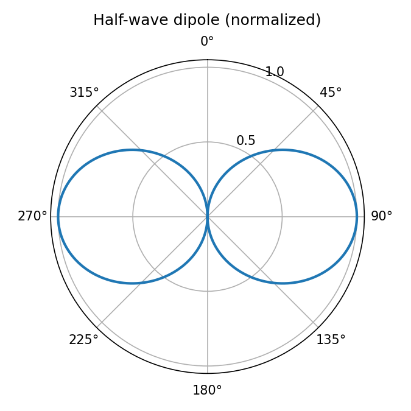

## Radiation pattern, directivity, and gain

**Directivity** is the ratio of radiation intensity in a given direction to the average radiation intensity:

$$
D(\theta,\phi) = \frac{4\pi\, U(\theta,\phi)}{P_{\text{rad}}}
$$

**Gain** includes losses through the radiation efficiency $e_r$:

$$
G = e_r \, D
$$

{fig-alt="Polar plot of a half-wave dipole elevation pattern, a figure-eight with nulls along the dipole axis." width="60%"}
