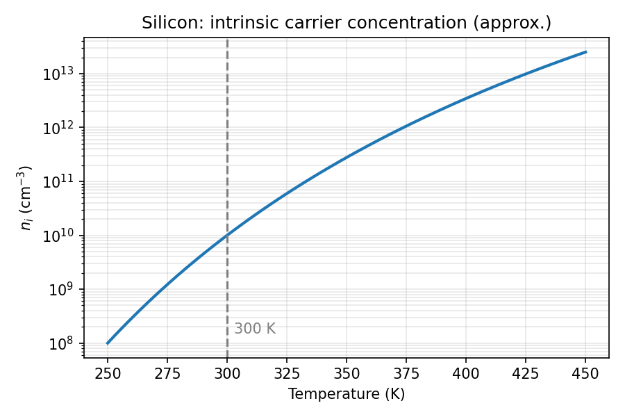

## Intrinsic carrier concentration

In an intrinsic semiconductor, electrons and holes are generated in pairs:

$$
n_i = \sqrt{N_c N_v}\, e^{-E_g / 2kT}
$$

{fig-alt="Semilog plot showing intrinsic carrier concentration of silicon rising steeply with temperature." width="80%"}
